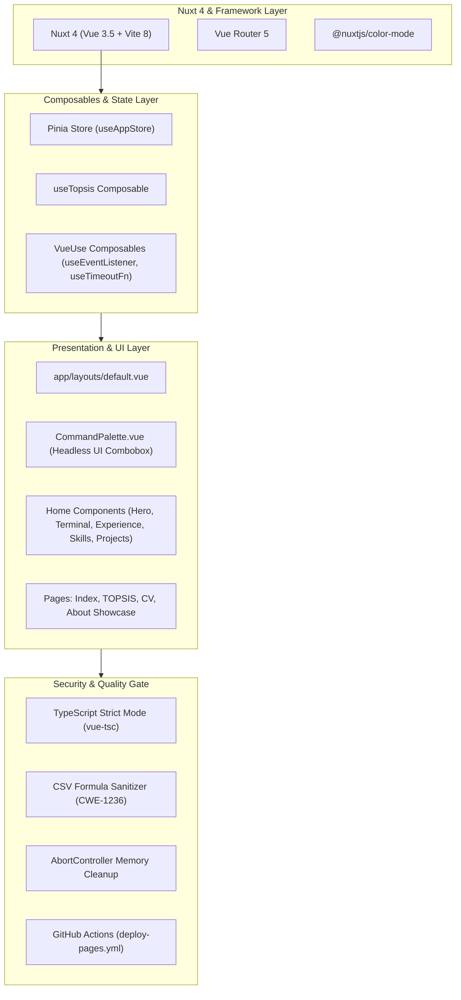

# Dian Adi Nugroho — Portfolio & Engineering Platform

A modern, high-performance web platform and engineering portfolio built with **Nuxt 4 (Vue 3)**, **TypeScript**, and **Tailwind CSS**. Engineered to support **Static Site Generation (SSG)** for [dianadi021.github.io](https://dianadi021.github.io) with full **Server-Side Rendering (SSR)** capability.

---

## 🌟 Overview & Key Modules

| Module / Page | Route | Description & Highlights |
| :--- | :--- | :--- |
| **Personal Portfolio** | [`/`](file:///home/wannacry021/Public/Project/Skuad/dianadi021.github.io/app/pages/index.vue) | Modular landing showcase: Hero branding, Live Developer Terminal, Core Pillars, Industrial Timeline, Tech Stack filter, and Featured Projects. |
| **TOPSIS SPK Engine** | [`/portofolio/topsis`](file:///home/wannacry021/Public/Project/Skuad/dianadi021.github.io/app/pages/portofolio/topsis.vue) | Real-time Multicriteria Decision Making (TOPSIS) calculator with mathematical guards, CSV Formula Injection defense (CWE-1236), and summary export. |
| **ATS-Friendly CV** | [`/mycv`](file:///home/wannacry021/Public/Project/Skuad/dianadi021.github.io/app/pages/mycv.vue) | Minimalist, ATS-optimized curriculum vitae with dedicated `@media print` styling for standard single/multi-page PDF export. |
| **Showcase & Sandbox** | [`/about`](file:///home/wannacry021/Public/Project/Skuad/dianadi021.github.io/app/pages/about.vue) | Interactive testbed for ecosystem packages: Zod validation, Axios with `AbortController`, Headless UI, Swiper, and SweetAlert2. |
| **Command Palette** | `Ctrl+K` / `⌘K` | Accessible, keyboard-first modal (`CommandPalette.vue`) for rapid navigation, theme toggling, and clipboard actions. |

---

## 🏛️ Architecture & Dependency Flow



---

## 🛠️ Tech Stack & Ecosystem

### Core Engine & Runtime
- **Framework:** [Nuxt 4](https://nuxt.com/) (`future.compatibilityVersion: 4`) with Nitro Engine (`node-server` / `static`).
- **Reactivity & Language:** Vue 3.5 (Composition API `<script setup>`) + TypeScript 5.9 (`strict: true`).
- **State Management:** [Pinia](https://pinia.vuejs.org/) (`useAppStore`) with modular SSR persistence.
- **Styling & Design System:** [Tailwind CSS v3](https://tailwindcss.com/) with `@tailwindcss/typography`, `@tailwindcss/forms`, `@tailwindcss/aspect-ratio`, and custom color palette (Prussian Blue `#023047`, Cerulean Blue `#219EBC`, Ice Blue `#8ECAE6`, Amber Gold `#FFB703`, UT Orange `#FB8500`).
- **UI & Interaction:** [Headless UI Vue](https://headlessui.com/), [VueUse](https://vueuse.org/), [Swiper](https://swiperjs.com/), [SweetAlert2](https://sweetalert2.github.io/).
- **Validation & Networking:** [Zod](https://zod.dev/) schema validation, [Axios](https://axios-http.com/) client with request/response interceptors.

---

## 📂 Project Directory Structure

```text
├── .github/workflows/
│   └── deploy-pages.yml       # GitHub Actions CI/CD pipeline (typecheck -> generate -> deploy)
├── app/
│   ├── app.vue                # Nuxt root application component
│   ├── assets/css/main.css    # Tailwind base styles and theme tokens
│   ├── components/
│   │   ├── home/              # Modular homepage sections (Hero, Terminal, Skills, Experience, Projects)
│   │   └── ui/                # Shared UI components (CommandPalette.vue)
│   ├── composables/
│   │   └── useTopsis.ts       # Pure mathematical engine for TOPSIS ranking
│   ├── layouts/
│   │   └── default.vue        # Global layout with responsive navbar, theme switch & footer
│   ├── pages/
│   │   ├── index.vue          # Landing portfolio
│   │   ├── about.vue          # Showcase & integration testbed
│   │   ├── mycv.vue           # ATS-friendly Curriculum Vitae
│   │   └── portofolio/
│   │       └── topsis.vue     # TOPSIS interactive calculator interface
│   ├── plugins/
│   │   ├── axios.ts           # Centralized HTTP client injection ($api)
│   │   ├── dayjs.ts           # Day.js date handling ($dayjs) with locale ID
│   │   └── sweetalert2.client.ts # SweetAlert2 SSR-safe injection ($swal)
│   ├── stores/
│   │   └── app.ts             # Pinia store for global application state
│   ├── types/
│   │   └── topsis.ts          # Strong TypeScript contracts & state definitions
│   └── utils/
│       └── cn.ts              # Utility class merging helper (clsx + tailwind-merge)
├── graphify-out/              # Architectural dependency graph and audit reports
├── nuxt.config.ts             # Nuxt configuration (modules, runtimeConfig, typescript strict)
├── tailwind.config.ts         # Tailwind design tokens, typography, and theme configuration
├── tsconfig.json              # TypeScript project references
└── package.json               # Dependencies and development scripts
```

---

## ⚡ CLI Workflow & Development Scripts

The following commands are defined in [`package.json`](file:///home/wannacry021/Public/Project/Skuad/dianadi021.github.io/package.json):

```bash
# Install dependencies
pnpm install

# 1. Start local development server with Hot Module Replacement (HMR)
pnpm run dev

# 2. Execute static TypeScript typechecking (vue-tsc)
pnpm run typecheck

# 3. Compile for production Node/Nitro server (SSR)
pnpm run build

# 4. Generate static Jamstack site for GitHub Pages (SSG)
pnpm run generate

# 5. Preview production build locally
pnpm run preview
```

---

## 🔒 Security & Code Standards

- **CSV Formula Injection Mitigation (CWE-1236):** Cell data exported via CSV on [`/portofolio/topsis`](file:///home/wannacry021/Public/Project/Skuad/dianadi021.github.io/app/pages/portofolio/topsis.vue) is sanitized against execution prefix vectors (`=`, `+`, `-`, `@`, `\t`, `\r`).
- **Resource Cleanup & Anti-Leak:** Browser listeners are managed via `useEventListener` (VueUse) with automatic unbinding on component unmount.
- **Fail-Fast CI Pipeline:** [.github/workflows/deploy-pages.yml](file:///home/wannacry021/Public/Project/Skuad/dianadi021.github.io/.github/workflows/deploy-pages.yml) validates `pnpm run typecheck` before `pnpm run generate`, halting deployment if any type errors are detected.
- **Strict Typing:** All composables, stores, and plugins operate under TypeScript `strict: true` without implicit `any`.

---

## 📄 License

This project is licensed under the [MIT License](file:///home/wannacry021/Public/Project/Skuad/dianadi021.github.io/LICENSE).
