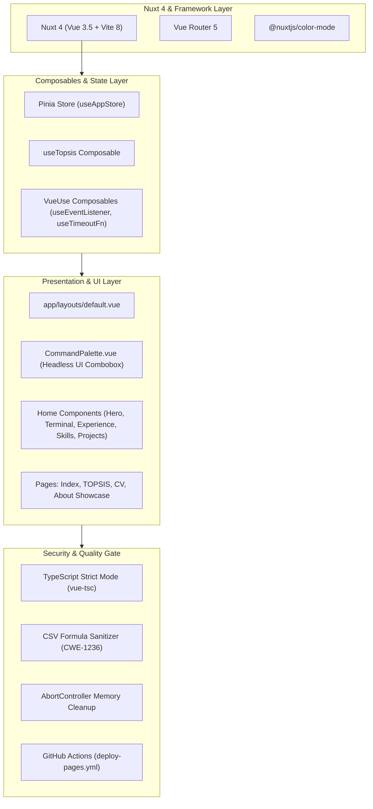

# Dian Adi Nugroho — Portfolio & Engineering Platform

A modern, high-performance web platform and engineering portfolio built with **Nuxt 4 (Vue 3)**, **TypeScript**, and **Tailwind CSS**. Engineered to support **Static Site Generation (SSG)** for [dianadi021.github.io](https://dianadi021.github.io) alongside full **Server-Side Rendering (SSR)** capability.

---

## 🌟 Overview & Key Modules

| Module / Page | Route | Description & Highlights |
| :--- | :--- | :--- |
| **Personal Portfolio** | [`/`](file:///home/wannacry021/Public/Project/Skuad/dianadi021.github.io/app/pages/index.vue) | Modular landing showcase: Hero branding, Live Developer Terminal, Core Pillars, Industrial Timeline, Tech Stack filter, and Featured Projects. |
| **TOPSIS SPK Engine** | [`/portofolio/topsis`](file:///home/wannacry021/Public/Project/Skuad/dianadi021.github.io/app/pages/portofolio/topsis.vue) | Real-time Multicriteria Decision Making (TOPSIS) calculator with mathematical guards, CSV Formula Injection defense (CWE-1236), and summary export. |
| **ATS-Friendly CV** | [`/mycv`](file:///home/wannacry021/Public/Project/Skuad/dianadi021.github.io/app/pages/mycv.vue) | Minimalist, ATS-optimized curriculum vitae with dedicated `@media print` styling for standard single/multi-page PDF export. |
| **Showcase & Sandbox** | [`/about`](file:///home/wannacry021/Public/Project/Skuad/dianadi021.github.io/app/pages/about.vue) | Interactive testbed for ecosystem packages: Zod validation, Axios with `AbortController`, Headless UI, Swiper, and SweetAlert2. |
| **Command Palette** | `Ctrl+K` / `⌘K` | Accessible, keyboard-first modal ([`CommandPalette.vue`](file:///home/wannacry021/Public/Project/Skuad/dianadi021.github.io/app/components/ui/CommandPalette.vue)) for rapid navigation, theme toggling, and clipboard actions. |

---

## 📦 Packages & Libraries Used

Platform ini memanfaatkan ekosistem modern Vue 3 dan Nuxt 4 yang dipetakan berdasarkan dependensi pada [`package.json`](file:///home/wannacry021/Public/Project/Skuad/dianadi021.github.io/package.json):

### 1. Runtime Dependencies (`dependencies`)

| Package / Library | Versi | Peran & Implementasi dalam Sistem |
| :--- | :--- | :--- |
| **`nuxt`** | `^4.5.2` | Framework inti berbasis Vue 3 dengan Nitro engine, file-based routing, auto-imports, dan SSR/SSG builder. |
| **`vue`** | `^3.5.43` | Reactivity engine inti berbasis Composition API (`<script setup>`). |
| **`vue-router`** | `^5.3.1` | Sistem routing client-side yang terintegrasi langsung dengan Nuxt. |
| **`pinia`** | `^4.0.3` | State management modular, type-safe, dan reaktif ([`app/stores/app.ts`](file:///home/wannacry021/Public/Project/Skuad/dianadi021.github.io/app/stores/app.ts)). |
| **`@nuxtjs/color-mode`** | `^4.0.1` | Pengaturan mode tema (dark/light/system) dengan integrasi kelas Tailwind tanpa flicker saat hidrasi SSR ([`app/layouts/default.vue`](file:///home/wannacry021/Public/Project/Skuad/dianadi021.github.io/app/layouts/default.vue)). |
| **`@vueuse/nuxt` & `@vueuse/core`** | `^15.0.0` | Kumpulan composables reaktif untuk browser API: auto cleanup listener (`useEventListener`), timer aman (`useTimeoutFn`), clipboard (`useClipboard`), dan reaktivitas storage (`useLocalStorage`). |
| **`@nuxt/icon`** | `^2.5.1` | Komponen ikon on-demand universal berbasis Iconify (Carbon, Heroicons, Lucide, Phosphor). |
| **`@headlessui/vue`** | `^1.7.23` | Komponen UI unstyled & accessible (WAI-ARIA compliant): Dialog, Combobox, Transition, Switch, Menu, dan Disclosure. |
| **`swiper`** | `^14.3.0` | Library touch slider & carousel responsif untuk showcase pada [`app/pages/about.vue`](file:///home/wannacry021/Public/Project/Skuad/dianadi021.github.io/app/pages/about.vue). |
| **`clsx`** | `^2.1.1` | Utilitas pembentuk string `className` secara kondisional. |
| **`tailwind-merge`** | `^3.7.0` | Resolusi konflik kelas utility Tailwind dalam helper `cn()` ([`app/utils/cn.ts`](file:///home/wannacry021/Public/Project/Skuad/dianadi021.github.io/app/utils/cn.ts)). |
| **`axios`** | `^1.20.0` | HTTP client berbasis Promise dengan plugin interceptor tersentralisasi ([`app/plugins/axios.ts`](file:///home/wannacry021/Public/Project/Skuad/dianadi021.github.io/app/plugins/axios.ts)). |
| **`zod`** | `^4.6.5` | Skema validasi runtime TypeScript-first untuk validasi input formulir dan payload API. |
| **`dayjs`** | `^1.11.23` | Library manipulasi tanggal ringan dengan plugin relative time dan locale ID ([`app/plugins/dayjs.ts`](file:///home/wannacry021/Public/Project/Skuad/dianadi021.github.io/app/plugins/dayjs.ts)). |
| **`sweetalert2`** | `^11.26.25` | Modal dialog interaktif dan toast notifikasi, diinjeksi via client-only plugin ([`app/plugins/sweetalert2.client.ts`](file:///home/wannacry021/Public/Project/Skuad/dianadi021.github.io/app/plugins/sweetalert2.client.ts)). |

### 2. Developer Tooling (`devDependencies`)

| Tool / Package | Versi | Peran & Penggunaan |
| :--- | :--- | :--- |
| **`typescript`** | `^5.9.3` | Kompiler bahasa dengan pengetatan tipe statis level sistem. |
| **`vue-tsc`** | `^3.3.12` | Type-checker khusus Single File Component (SFC) Vue untuk perintah `pnpm run typecheck`. |
| **`@types/node`** | `^26.6.4` | Deklarasi tipe sistem operasi dan lingkungan Node.js. |
| **`@nuxtjs/tailwindcss`** | `^6.14.0` | Integrasi pipeline Tailwind CSS v3 ke dalam siklus kompilasi Nuxt. |
| **`@pinia/nuxt`** | `^1.0.2` | Modul integrasi resmi Pinia untuk Nuxt dengan auto-import store. |
| **`@tailwindcss/typography`** | `^0.5.20` | Plugin Tailwind untuk formatting konten prosa dan artikel HTML otomatis. |
| **`@tailwindcss/forms`** | `^0.5.11` | Plugin reset elemen form input HTML lintas peramban. |
| **`@tailwindcss/aspect-ratio`** | `^0.4.2` | Utilitas rasio aspek elemen kartu dan media visual responsif. |
| **`@iconify-json/heroicons`** | `^1.2.3` | Kumpulan koleksi ikon Heroicons lokal untuk `@nuxt/icon`. |
| **`@iconify-json/lucide`** | `^1.2.141` | Kumpulan koleksi ikon Lucide lokal untuk `@nuxt/icon`. |
| **`@iconify-json/carbon`** | `^1.2.28` | Kumpulan koleksi ikon Carbon lokal untuk `@nuxt/icon`. |
| **`@iconify-json/ph`** | `^1.2.2` | Kumpulan koleksi ikon Phosphor lokal untuk `@nuxt/icon`. |

### 3. Vendor Assets & Skrip Statis

- **Font Awesome `@7.3.1` (Vendor Bundle):** Terpasang lokal pada `public/assets/scripts/vendor/font-awesome/@7.3.1/` dan dimuat via konfigurasi head pada [`nuxt.config.ts`](file:///home/wannacry021/Public/Project/Skuad/dianadi021.github.io/nuxt.config.ts).

---

## 🏛️ Architecture & Dependency Flow



---

## ⚖️ Governance & Agent Rules ([`AGENTS.md`](file:///home/wannacry021/Public/Project/Skuad/dianadi021.github.io/AGENTS.md))

Pengembangan kode di repositori ini dikendalikan oleh konstitusi perilaku permanen pada [AGENTS.md](file:///home/wannacry021/Public/Project/Skuad/dianadi021.github.io/AGENTS.md) dan disinkronkan ke [.clirules](file:///home/wannacry021/Public/Project/Skuad/dianadi021.github.io/.clirules) serta [.codexrules](file:///home/wannacry021/Public/Project/Skuad/dianadi021.github.io/.codexrules):

1. **Core Operating Principles:** *Direct & Concise* (tanpa basa-basi), *Zero Speculation* (larangan mengasumsikan aturan bisnis tanpa data), dan *Token Economy*.
2. **Separation of Concerns:**
   - **Rules (`AGENTS.md`):** Aturan mutlak tata kelola, keamanan, dan standar verifikasi.
   - **Roadmap & Tasks (`TODO.md`):** Backlog terstruktur pelacak kualitas hasil audit & review.
   - **Workflow Procedures (`.agents/skills/`):** Prosedur on-demand (`sdlc-audit`, `review-frontend-web`, `review-typescript-node`).
3. **Navigasi Berbasis Indeks:** Memanfaatkan `graphify-out/GRAPH_REPORT.md` untuk eksplorasi kode dengan *top-k strict context* dalam *blast radius*.
4. **Technical Guardrails:**
   - Strict typing aktif di konfigurasi; dilarang menggunakan `any`.
   - Sanitasi input dan proteksi formula injection (CWE-1236).
   - Pembersihan lifecycle event listener via `useEventListener` dari `@vueuse/core`.
5. **Conflict Decision Gate:** Wajib menjalankan validasi `pnpm run typecheck` sebelum melakukan commit.

---

## 📂 Project Directory Structure

```text
├── .github/workflows/
│   └── deploy-pages.yml       # GitHub Actions CI/CD pipeline (typecheck -> generate -> deploy)
├── .clirules                  # Aturan agen Antigravity CLI berbasis AGENTS.md
├── .codexrules                # Aturan agen OpenAI Codex berbasis AGENTS.md
├── AGENTS.md                  # Konstitusi permanen rekayasa perangkat lunak
├── TODO.md                    # Roadmap engineering & pelacak temuan review
├── app/
│   ├── app.vue                # Nuxt root application component
│   ├── assets/css/main.css    # Tailwind base styles dan theme tokens
│   ├── components/
│   │   ├── home/              # Komponen modular homepage (Hero, Terminal, Skills, Experience, Projects, Metrics)
│   │   └── ui/                # Shared UI components (CommandPalette.vue)
│   ├── composables/
│   │   └── useTopsis.ts       # Engine komputasi matematis TOPSIS
│   ├── layouts/
│   │   └── default.vue        # Global layout dengan navbar responsif, theme toggle & footer
│   ├── pages/
│   │   ├── index.vue          # Landing portfolio personal
│   │   ├── about.vue          # Showcase & integrasi library
│   │   ├── mycv.vue           # Curriculum Vitae ramah ATS
│   │   └── portofolio/
│   │       └── topsis.vue     # Antarmuka kalkulator interaktif TOPSIS
│   ├── plugins/
│   │   ├── axios.ts           # Centralized HTTP client injection ($api)
│   │   ├── dayjs.ts           # Day.js date handling ($dayjs) dengan locale ID
│   │   └── sweetalert2.client.ts # SweetAlert2 SSR-safe injection ($swal)
│   ├── stores/
│   │   └── app.ts             # Pinia store untuk global state aplikasi
│   ├── types/
│   │   └── topsis.ts          # Kontrak antarmuka TypeScript kalkulator TOPSIS
│   └── utils/
│       └── cn.ts              # Helper penggabung class Tailwind (clsx + tailwind-merge)
├── graphify-out/              # Peta graf dependensi dan laporan arsitektur
├── nuxt.config.ts             # Konfigurasi Nuxt, modul, runtimeConfig, & typescript strict
├── tailwind.config.ts         # Konfigurasi Tailwind, palet warna, & dark mode class
├── tsconfig.json              # TypeScript project references
└── package.json               # Daftar script dan dependensi package
```

---

## ⚡ CLI Workflow & Development Scripts

Daftar perintah yang didefinisikan dalam [`package.json`](file:///home/wannacry021/Public/Project/Skuad/dianadi021.github.io/package.json):

```bash
# 1. Menjalankan server pengembangan lokal (Hot Module Replacement aktif)
pnpm run dev

# 2. Melakukan pemeriksaan tipe statis TypeScript (vue-tsc)
pnpm run typecheck

# 3. Menghasilkan build produksi untuk server Node.js / Nitro (SSR)
pnpm run build

# 4. Melakukan pre-rendering halaman ke format statis untuk GitHub Pages (SSG)
pnpm run generate

# 5. Menjalankan preview lokal dari hasil kompilasi produksi
pnpm run preview
```

---

## 🔒 Security & Code Standards

- **Mitigasi CSV Formula Injection (CWE-1236):** Seluruh sel ekspor CSV pada [`app/pages/portofolio/topsis.vue`](file:///home/wannacry021/Public/Project/Skuad/dianadi021.github.io/app/pages/portofolio/topsis.vue) disanitasi terhadap karakter prefix formula (`=`, `+`, `-`, `@`, `\t`, `\r`).
- **Pembersihan Sumber Daya & Anti-Leak:** Browser event listener dikelola menggunakan `useEventListener` (`@vueuse/core`) yang otomatis di-unbind saat unmount.
- **Fail-Fast CI Quality Gate:** [.github/workflows/deploy-pages.yml](file:///home/wannacry021/Public/Project/Skuad/dianadi021.github.io/.github/workflows/deploy-pages.yml) menjalankan validasi `pnpm run typecheck` sebelum `pnpm run generate`.
- **Strict Typing:** Seluruh composable, store, plugin, dan komponen berjalan di bawah opsi compiler `strict: true` tanpa toleransi terhadap tipe implisit `any`.

---

## 📄 License

Proyek ini dilisensikan di bawah [MIT License](file:///home/wannacry021/Public/Project/Skuad/dianadi021.github.io/LICENSE).
